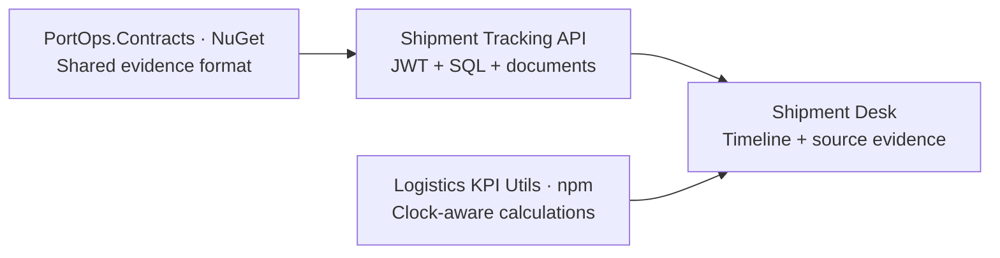

# Shipment Desk: from a shipment to operational evidence

A synthetic logistics demonstration backed by the real .NET API, JWT identities and SQL Server. The API consumes **PortOps.Contracts 0.2.0**; the browser calculates metrics using **Logistics KPI Utils 0.2.0**. No model provider, terminal account or cloud subscription is required.

## Try it independently

Requires Python 3, Docker Compose and an amd64-compatible Docker environment. Start Docker Desktop, clone this repository or download its ZIP, then run from the repository root:

```bash
python3 scripts/start-demo.py
```

The helper creates a private `.env` only when none exists, generates separate strong SQL/dispatcher passwords and a JWT signing key, and starts the released image. It preserves existing configuration. Open `http://localhost:5001`; sign in as `demo-dispatcher` using your local `.env` value for `DEMO_DISPATCHER_PASSWORD`. No package-registry login is needed. The file is ignored by Git and Docker builds; never publish it.

The published image is linux/amd64. SQL Server uses its Developer edition for this local demonstration. On Apple Silicon, Docker emulation must support SQL Server; resource and compatibility requirements are described in [PACKAGE.md](PACKAGE.md). Allocate sufficient memory to Docker. A new machine may spend time downloading images; automated verification is not a human usability study or a universal setup-time promise.

## How the pieces connect



The API stores and authorizes evidence; the contracts define its shape; the KPI library calculates results in the browser. The [delivery board](https://github.com/users/phlppgdfry/projects/6) links the implementation issues to release and verification evidence.

## The baseline

The analytical clock starts at **12 October 2026, 12:00 UTC**. Planning evidence is observed at 04:00; gate and hold evidence is observed two minutes after its occurrence. Receipt time in SQL is the actual server receipt time.

| Shipment | Plan | Gate arrival | Gate departure | Recorded hold |
| --- | --- | --- | --- | --- |
| Spare parts | 08:00 | 08:20 | Unknown | Customs hold at 08:30, unresolved |
| Synthetic equipment | 05:00 | 05:04 | 08:04 | None |
| Pending arrival | 10:00 | Unknown | Unknown | None |

With five minutes' punctuality tolerance, the expected baseline is:

- **50% completed on time:** one of two completed/evaluable arrivals.
- **1 overdue arrival:** the 10:00 plan is overdue at 12:00 without an actual arrival.
- **3 hours mean completed dwell:** only the equipment visit is complete; open visits are excluded.
- **1 open hold:** the spare-parts customs hold remains unresolved.

These are fixture results, not a terminal's performance. The dashboard shows denominators/exclusions. Metrics cover the loaded set of at most 100 customer-visible shipments. Search filters the table, not the metric scope.

## Five-step guided scenario

1. **Create shipment.** The browser creates a real SQL-backed synthetic shipment with an idempotency key, confirms it and records its 08:00 plan.
2. **Record arrival.** Record gate-in at 08:20; the arrival is twenty minutes late and the shipment enters transit.
3. **Open hold.** Record a customs hold at 08:30 and upload a valid synthetic PDF manifest. Try a blocked action separately to see a rejection.
4. **Release and depart.** Release the same hold at 09:00, record departure at 10:20 and complete the valid status sequence to Delivered. The visit has two hours' elapsed dwell.
5. **Review KPIs.** With the unchanged baseline, completed punctuality becomes **33.3%** (one of three) and mean completed dwell becomes **2.5 hours** (three and two hours). The original pending arrival remains overdue and the original spare-parts hold stays open.

The guided scenario preserves its create key and event IDs across step retries. An identical event is replayed without duplication; changed evidence under the same ID conflicts. Starting another scenario uses a new create key. No physical cargo release is authorized by this portfolio software.

## Explore time and failure

Set the clock to `2026-10-12T08:10:00Z`: only the equipment arrival is completed, so punctuality is 100%; the later customs observation is not yet visible to this analytical view. Restore 12:00 to return to the baseline. A timestamp without a timezone is rejected and the prior valid metrics remain visible.

The clock changes analytics; it does not undo recorded commands or release holds. Command policy conservatively checks the latest recorded state of each hold. OutForDelivery and Delivered are rejected while a recorded hold is unresolved; departure also requires a prior gate arrival and released applicable holds.

For status recovery, create a Draft shipment and attempt Delivered directly. The API returns 422 with a visible error. Confirm it, then follow InTransit → OutForDelivery → Delivered. Status-history persistence is covered in real SQL tests.

## Evidence contract and mapping

The API exposes `ShipmentEventEnvelope` with schema version 1:

- `shipmentId` and `customerId` come from the authenticated server boundary.
- `referenceId` is the source event ID used for ingestion replay.
- `correlationId` groups events for a visit or hold.
- `event.type` defines the meaning of the timestamp.
- `event.occurredAt` is the target time for `arrival_plan`, and occurrence time for actual gate/hold events. A plan is never treated as an actual arrival.
- `event.evidence.observedAt` records the source observation time; it can differ from occurrence. `ReceivedAt` is stored separately in SQL.

Supported types: `arrival_plan`, `gate_in`, `gate_out`, `hold_opened`, `hold_released`. Requests require explicit timezone offsets and at most millisecond precision. This preview permits one gate-in/out visit per shipment. It validates source shape and chronology, not the truth of a source's claim.

The browser excludes evidence observed after the clock. Future-dated actual arrival values are not completed arrivals. Conflicting latest plans are excluded with a warning instead of resolved by arbitrary IDs. Missing actual times remain pending/overdue/unscheduled as appropriate. No business holiday calendar or prediction is applied.

## Customer boundary

Every operational query is customer-scoped. Roles do not bypass that scope. Details, lists, search, documents, events and operations all obey it; cache keys include the customer. Creation replay is additionally scoped to the caller and runs after authorization.

Public registration generates a new server-owned customer ID and grants only Customer. Client-supplied membership/role fields are ignored. Shared customer membership and privileged roles require trusted provisioning; there is no production onboarding system here. The reserved demo name cannot be claimed through public registration. Tokens are kept in browser module memory; logout clears the previous data/forms and late responses from an earlier session are discarded.

[Migration and boundary details](CUSTOMER_ISOLATION.md) explain old records and remaining scope.

## Build and verify from source

Requires Node.js 22+ and .NET 10 SDK in addition to Docker:

```bash
python3 scripts/prepare-demo.py
dotnet test ShipmentTracking.sln
npm --prefix demo test
docker build -f src/WebAPI/Dockerfile -t shipment-package:verify .
```

The bootstrap downloads the two **released artifacts**, checks pinned SHA-256 values and installs the npm tarball as a local dependency. npm lock integrity also applies. NuGet source mapping resolves PortOps.Contracts only from the verified local feed; a repository-local cache avoids unrelated global package-cache versions. Generated artifacts/vendor files are not committed. Dependency installation skips lifecycle scripts.

CI executes the actual image with SQL Server, runs the browser scenario on desktop/mobile and verifies real JWT isolation, PDF upload/download, status recovery, held departure and replay protection. [VERIFICATION.md](VERIFICATION.md) links the evidence and documents the visual comparison.

## Stop and repeat

```bash
docker compose --env-file .env -p shipment-desk -f docker-compose.package.yml down
```

Data is preserved. Changing a password in `.env` does not reset an existing database account. For a deliberately fresh disposable demonstration, use another Compose project name and configuration or explicitly remove only its known synthetic volumes. Do not discard real data to reset a demo.

This is a 0.2.0 preview. Production identity, customer invitations, real terminal adapters, backups and cloud operations remain separate future work.
