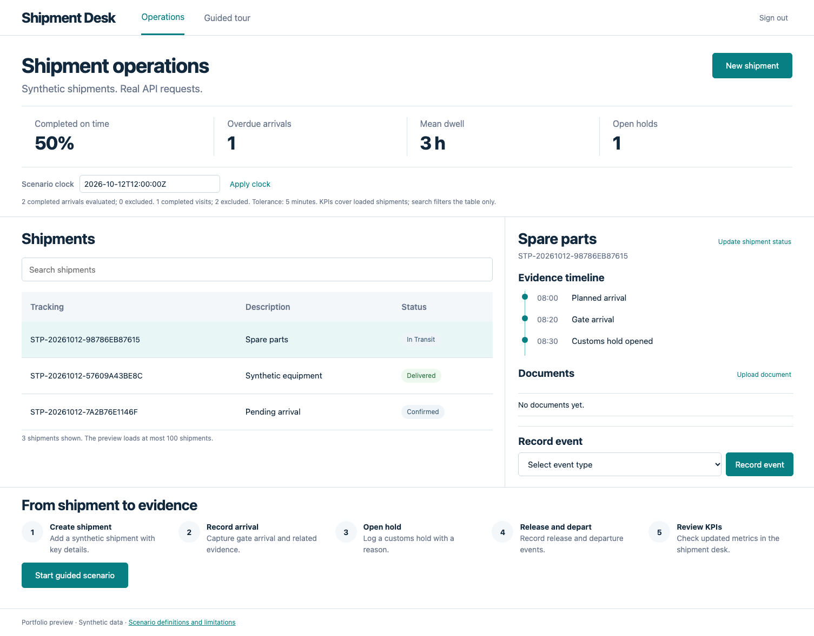
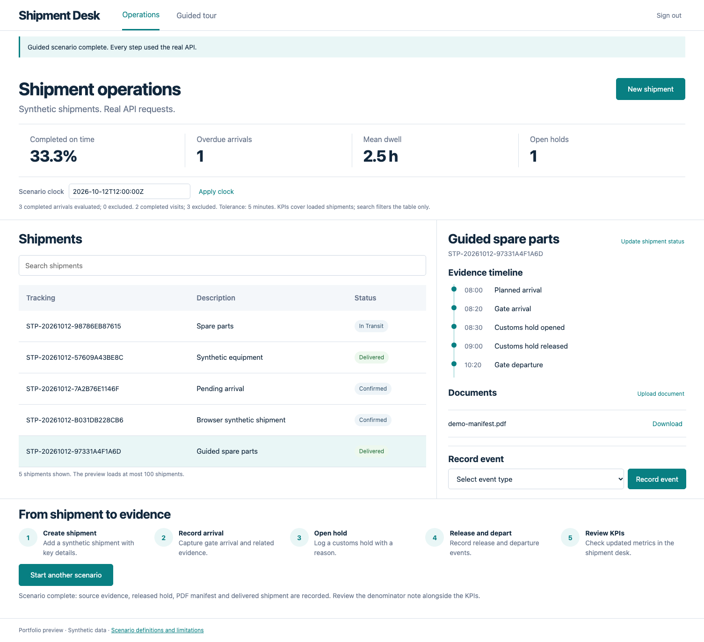
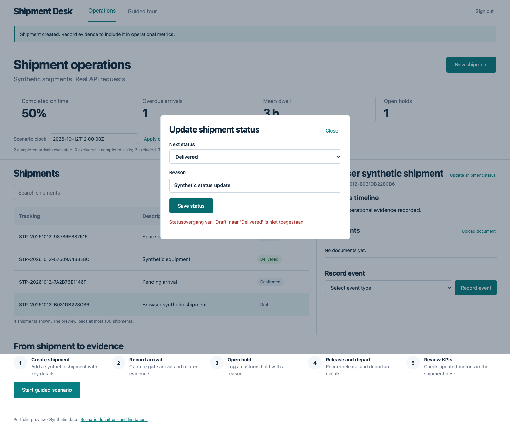
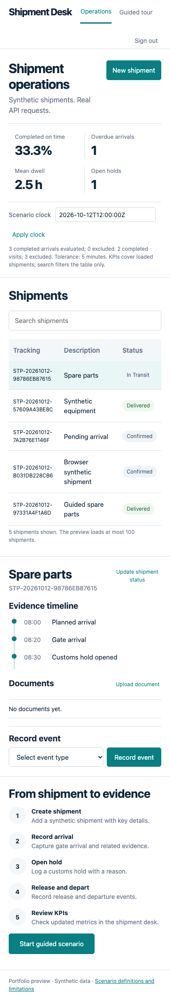

# Verification evidence

## Scope and environment

The real SQL-backed candidate was tested through `http://localhost:5001`. Desktop viewport: **1505 × 1045**, matching the concept's native dimensions. Mobile: **390 × 844**. Browser plugin was not available; Playwright Chromium provided actual rendered checks, screenshots, a workflow recording and console monitoring. Local development uses a native ARM API build and an emulated amd64 SQL Server; CI separately validates the bundled linux/amd64 release candidate without a source bind mount.

## Checks

| Check | Evidence |
| --- | --- |
| Page identity, meaningful content and no framework overlay | Browser proof and screenshots |
| No unexpected browser errors/warnings | Browser proof; one deliberate 422 validation rejection is recorded separately |
| Baseline metrics | 50% punctuality, 1 overdue arrival, 3 h completed dwell, 1 open hold |
| Explicit clock and invalid-clock recovery | 08:10 recalculation; timezone-less input rejected without overwriting valid metrics |
| Source evidence inspection | Event, source, correlation, occurrence/target and observation values shown in a working dialog |
| Filter, create, status rejection and recovery | Actual API requests and visible resulting state |
| Document upload/download | Valid PDF saved and downloaded; cache invalidation checked |
| Five-step guided scenario | Actual creation, arrival, hold, release, delivered state and KPI review |
| Account switch | Prior rows, documents, forms and inspector state cleared; new Customer sees no dispatcher data |
| Mobile | No horizontal page overflow; table/inspector/tour stack |
| Real JWT scope and replay | API proof verifies cross-customer denials, no client-selected membership/role escalation and no unauthorized replay |
| SQL migration and persistence | Real SQL tests cover status-history inserts and legacy known/unknown ownership upgrade |

Formal automated suites: **132 PortOps/contract tests, 23 KPI tests, 31 shipment unit tests, 15 shipment integration tests (including 2 real-SQL tests), and 6 dashboard mapping tests**. Total: **207**, plus the browser flow, independent NuGet consumer and real JWT HTTP smoke checks. CI is the authoritative repeatable verification for the checked-in release.

[Browser proof JSON](assets/browser-proof.json) · [API proof JSON](assets/api-proof.json) · [Recorded workflow](assets/shipment-desk-walkthrough.mp4)

## Visual fidelity ledger

The accepted concept and final browser screenshots were inspected together with `view_image` at native desktop width. The full-page screenshot includes functional controls and the preview footer beyond the concept's primary surface.

| Comparison point | Result / intentional difference |
| --- | --- |
| Composition | Header, open four-metric strip, 62/38 table/inspector and five-step tour preserved |
| Palette | White canvas, navy text, teal actions and cool gray dividers preserved; sign-out utility corrected to muted text |
| Typography | Explicit system-font hierarchy for headings, controls, table and captions; mobile wrapping verified |
| Container model | Open table/rails rather than nested card grids; selected row and restrained status styling preserved |
| Inspector | Source metadata moved into an actual evidence dialog; upload uses a dialog to keep the primary desk compact |
| Copy | Core heading/nav/actions retained; clock editing, denominator/exclusion note, status action and preview footer are necessary functional additions |
| Data/assets | Actual tracking numbers and an honest empty document state replace concept placeholders; uploaded PDF appears after the real scenario |
| Responsive | Metric strip becomes two columns, inspector/tour stack, dialogs fit the viewport |

Material layout repairs: reduced inspector density, moved upload/status actions into compact positions, and removed default file-input chrome from the main view. No unresolved clipping or horizontal mobile overflow was observed. Functional additions and runtime data are recorded deviations, not invented business claims.

## Screenshots

### Baseline

### Scenario completed

### Validation and recovery

### Mobile

## Repeat

Run `python3 scripts/prepare-demo.py`, the .NET and mapping suites, then start a fresh synthetic Compose project. Provide the local dispatcher password only through the test process environment and run `npm --prefix demo run test:browser` and `python3 scripts/package-smoke.py`. Browser tests require the documented baseline, so use a disposable fresh fixture database rather than erasing real data. CI executes this sequence automatically.

Public recordings contain only synthetic records and masked password inputs; no JWT tokens or local secret values are attached. The automated fixture run is not a production certification or a human usability study.
