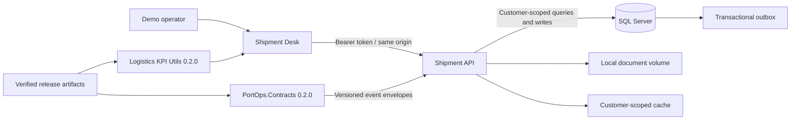

# Architecture and reliability model

## Request path

```text
Client → rate limiter → JWT/role policy → idempotency middleware → MediatR handler
      → EF Core transaction (Shipment + OutboxMessage) → SQL Server
                                                 ↓
                                  Outbox worker → Azure Service Bus
                                                 ↓
                                downstream notification/audit consumers
```

The status-command handler adds the state change and the serialized event to the same `ApplicationDbContext`. `SaveChangesAsync` commits them atomically. The worker retries unpublished rows up to ten times and preserves the error for diagnosis; a Service Bus queue then supplies its own dead-letter queue for messages that cannot be delivered.

## Operational contracts

- `POST /api/shipments` accepts an `Idempotency-Key`; equal requests replay the stored successful result and conflicting payloads return `409`.
- Shipment details use cache-aside caching with a five-minute TTL and command-side invalidation. Redis is optional; the cost-conscious Azure profile uses the in-memory implementation.
- `/health` and `/ready` execute database health checks.
- Status-changing endpoints require `Dispatcher`, `Driver` or `Administrator`; creation requires `Dispatcher` or `Administrator`.
- Azure Key Vault is enabled by setting `KeyVault__Uri`; the application uses `DefaultAzureCredential`, so Container Apps can authenticate with its managed identity.

## Deployment model

`infra/main.bicep` declares Azure Container Apps, SQL Database, Key Vault, Application Insights/Log Analytics and Storage. Redis is deliberately omitted; Service Bus is opt-in and disabled by default; the Container App scales to zero when idle. Store generated connection strings and the JWT secret in Key Vault. Before a production release, apply the checked-in EF migration and grant the Container App identity access to Key Vault, Blob Storage and Service Bus when it is enabled.

## Connected demonstration



The libraries are dependencies, not network services. They are downloaded at source-build preparation time, verified and bundled. Runtime use requires no package-registry credentials. The API owns authorization and persistence; the npm library owns metric definitions; the NuGet library owns shared record shape and documentation. A versioned mapping connects the event ledger to arrival and visit inputs.

Analytics uses an explicit as-of clock; command policy uses the recorded hold ledger. A forecast is not an actual arrival, a source observation is not automatically verified truth, and Delivered is application bookkeeping rather than authority to release real cargo. The local demo disables Azure delivery when its configuration is absent.

See [DEMO.md](DEMO.md), [CUSTOMER_ISOLATION.md](CUSTOMER_ISOLATION.md) and [VERIFICATION.md](VERIFICATION.md) for setup, boundary evidence and limitations.
